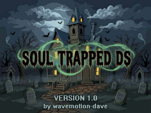
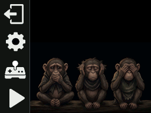

# SoulTrapped-DS - MSX Soul Trapped Emulator

This Emulator is specifically for the massive 14MB "Soul Trapped - The House" game as
created for the MSXDev25 competition. There is a newer 1.1 version of this game that
is worth seeking out as it has some fixes.

Requires a DSi/XL/LL and will NOT run in DS-Lite or 'Compatibility' mode. The game
will check to make sure you have the needed processing power and RAM to run the game.

Besides SoulTrapped-DS.nds, the only other file needed is the 14MB game ROM

Place this file exactly named "Soul Trapped.rom" in the /roms folder on your SD card.

If you launch the emulator and get no warning screens, you will be greated with the main menu as such:

Assuming you have nothing to configure, just press the PLAY icon.

# Donations Welcome (but never required!)

These hobby emulators have been a labor of love. An embarassing amount of development time has gone into it as I've strived to provide an enjoyable retro experience on the DS handheld. It's free to use and always will be, however if you feel inclined to buy me a virtual coffee for the effort, that would be beyond amazing!

Copyright :
-----------------------
SoulTrapped-DS is Copyright (c) 2026 Dave Bernazzani (wavemotion-dave)

As long as there is no commercial use (i.e. no profit is made),
copying and distribution of this emulator, it's source code
and associated readme files, with or without modification, 
are permitted in any medium without royalty provided this 
copyright notice is used and wavemotion-dave (SoulTrapped-DS),
and Marat Fayzullin (fMSX core) are thanked profusely.

The sound driver (ay38910) are libraries from FluBBa (Fredrik Ahlström) 
and those copyrights remain his.

lzav compression (for save states) is Copyright (c) 2023-2025 Aleksey 
Vaneev and used by permission of the generous MIT license.

The SoulTrapped-DS emulator is offered as-is, without any warranty.

"Eerie" opening jingle composed by Deodo and released as royalty free music.

Saving Progress :
-----------------------
SoulTrapped-DS provides two independent save slots to save your progress as you play. 

Press the MSX key in the lower right to access the icon menu system
and you can save or restore directly to one of two save slots. These
can be used anytime.

Version History :
-----------------------

Version 1.0 - 06-Nov-2026 by wavemotion-dave
* First major version released.
